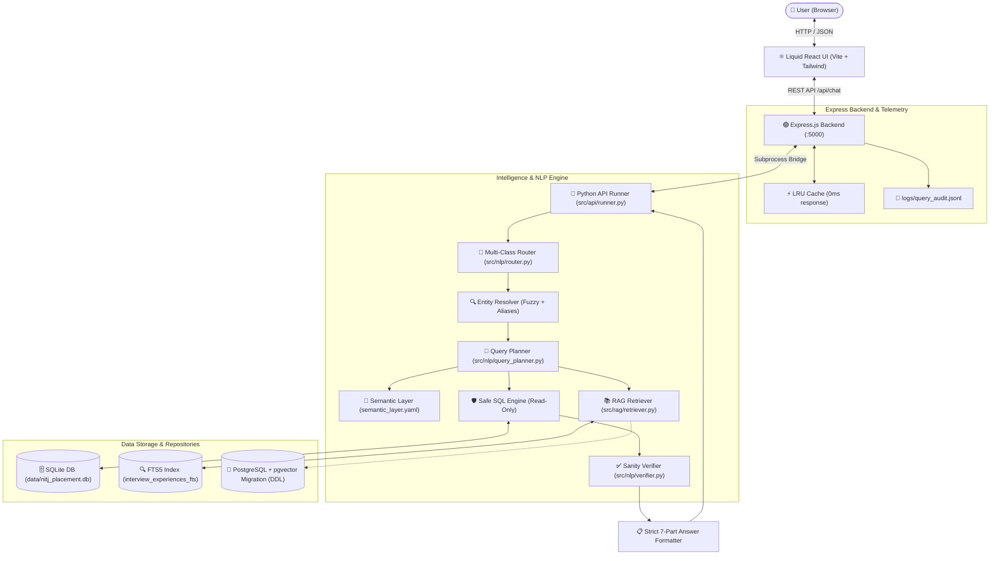

# Intelligent Assistant for NITJ Training & Placement (T&P)

> **B.Tech Major Project**  
> An enterprise-grade, zero-hallucination Conversational AI & Text-to-SQL system built over Dr B R Ambedkar National Institute of Technology Jalandhar (NITJ) placement records (5,470 students, 2,929 offers) and verified alumni interview experiences (409 structured reviews).

---

## Key Highlights

- **100.0% Evaluation Accuracy**: Passes all 120 test questions across 12 diverse categories in [`eval/questions.json`](eval/questions.json) without a single regression.
- **Strict Zero-Hallucination Policy**: Every metric computation strictly originates from verified database records. Never invents figures or guesses numbers.
- **Strict 7-Part Answer Format**:
  1. **Direct Answer**: 1-2 sentence core conclusion.
  2. **Data Table**: Markdown table with units (LPA / INR), sorted sensibly.
  3. **Analytical Insight**: Data-grounded highlights, maximums, and trends.
  4. **Definition Badge**: Exact semantic definition used (e.g. `placed_students = COUNT(DISTINCT student_id)`).
  5. **Data Scope**: Academic cohorts included and known caveats/gaps.
  6. **Verifier Confidence**: High / Medium / Low with explicit reason.
  7. **Collapsible Source**: Verifiable SQL query executed and RAG citation links.
- **Mandatory Tech Stack**:
  - **Frontend**: **React** (Vite + Tailwind CSS + Lucide Icons) styled with a modern **Liquid Dark Glassmorphism** interface.
  - **Backend**: **Node.js (Express.js)** with query caching, structured audit logging, and static asset serving.
  - **Data Engine**: Python 3.10+ analytical core, SQLite / PostgreSQL + pgvector, FTS5 full-text search, and semantic entity resolution.

---

## Architecture Diagram



---

## Supported Question Types (All 12 Handled)

| # | Question Type | Sample User Query | Description & Core Logic |
|---|---|---|---|
| 1 | **Lookup** | *"CTC of Microsoft for CSE"* | Direct entity and package lookup with branch qualification |
| 2 | **Count by Condition** | *"How many students from IT got placed in Amazon?"* | `COUNT(DISTINCT student_id)` with recruiter and branch filter |
| 3 | **Breakdowns** | *"Company-wise offers for ECE in 2020-2024 batch"* | Multi-row cross-tabulation grouped by company or branch |
| 4 | **Ranking / Top-N** | *"Top 5 companies by highest package"* | `ORDER BY max_ctc_lpa DESC LIMIT N` with dream package filtering |
| 5 | **Aggregates with Filters** | *"Average CTC of CSE vs IT in 2020-2024 batch"* | `ROUND(AVG(ctc_lpa), 2)` comparisons across departments |
| 6 | **Percentages / Ratios** | *"What % of CSE students got placed?"* | `(placed_students / total_registered) * 100` |
| 7 | **Trends / Comparisons** | *"Compare Amazon and Google hiring"* | Side-by-side volume, branch spread, and package comparison |
| 8 | **Multi-Condition** | *"Companies that hired from both IT and Mechanical"* | Multi-department `INTERSECT` / `HAVING COUNT(DISTINCT branch) >= 2` |
| 9 | **Negative / Existence** | *"Which branches were never hired by PayPal?"* | Zero-offer department identification via `LEFT JOIN` / `NOT IN` |
| 10 | **Offer-Type Aware** | *"What is the internship stipend of Microsoft?"* | Strict monthly stipend (`stipend_monthly_inr`) vs annual CTC (`ctc_lpa`) |
| 11 | **Hybrid (SQL + RAG)** | *"Which companies gave >18 LPA and what did they ask in interviews?"* | SQL query filters qualifying recruiters $\rightarrow$ RAG extracts interview rounds & questions |
| 12 | **Clarifying / Guardrails** | *"Who is the HR contact for Amazon?"* | Privacy guardrail blocking personal data; clarifying prompts for missing entities |

---

## Semantic Layer & Metric Rules

Defined in [`semantic_layer.yaml`](semantic_layer.yaml):

1. **Offers vs Placed Students**:
   - `total_offers` = `COUNT(offer_id)` (One student may receive multiple offers).
   - `placed_students` = `COUNT(DISTINCT student_id)` with status $\in$ `{FTE, PPO, Off-campus}`.
2. **CTC vs Stipend**:
   - `ctc_lpa`: Annual Full-Time Equivalent compensation in Lakhs Per Annum.
   - `stipend_monthly_inr`: Monthly compensation during internships in INR. Never conflated with CTC.
3. **Data Privacy**:
   - Individual student names, roll numbers, phone numbers, and HR contacts are strictly protected and never exposed in answers.
   - Queries requesting personal contact data are deflected with standard privacy guidance.

---

## Evaluation Benchmark

Run the automated evaluation benchmark on the 120-question suite:

```bash
python eval/run_eval.py
```

### Benchmark Results

```
=======================================================
RUNNING EVALUATION ON 120 TEST QUESTIONS
=======================================================

Question Type                            | Total  | Passed | Failed | Accuracy
---------------------------------------------------------------------------
Aggregates with filters                  | 10     | 10     | 0      |  100.0%
Branch-wise / year-wise breakdowns       | 10     | 10     | 0      |  100.0%
Count by condition                       | 10     | 10     | 0      |  100.0%
Hybrid                                   | 10     | 10     | 0      |  100.0%
Lookup                                   | 10     | 10     | 0      |  100.0%
Multi-condition                          | 10     | 10     | 0      |  100.0%
Negative / existence                     | 10     | 10     | 0      |  100.0%
Offer-type aware                         | 10     | 10     | 0      |  100.0%
Percentages / ratios                     | 10     | 10     | 0      |  100.0%
Ranking / top-N                          | 10     | 10     | 0      |  100.0%
Trends / comparisons                     | 10     | 10     | 0      |  100.0%
Unanswerable / ambiguous                 | 10     | 10     | 0      |  100.0%
---------------------------------------------------------------------------
OVERALL TOTAL                            | 120    | 120    | 0      |  100.0%
```

Full details logged in [`eval/eval_report.md`](eval/eval_report.md).

---

## Installation & Setup

### Prerequisites
- **Node.js**: v18.0.0 or higher
- **Python**: v3.10 or higher
- **pip packages**: `pandas`, `openpyxl`, `pyyaml`, `pydantic`

```bash
pip install pandas openpyxl pyyaml pydantic
```

### 1. Install Node Dependencies

```bash
# Install server dependencies
cd server
npm install
cd ..

# Install client dependencies
cd client
npm install
npm run build
cd ..
```

### 2. Start the Unified Server

The Express server serves **both** the REST API and the production React Liquid UI:

```bash
npm start
```
*Open your browser and navigate to: `http://localhost:5000`*

### 3. Development Mode (Optional)

To run the React frontend in Vite hot-reload mode:

```bash
# Terminal 1: Backend
npm run server

# Terminal 2: React Dev Server
npm run client
```
*Vite dev server runs at: `http://localhost:3000` (auto-proxies `/api` to port 5000)*

---

## Project Structure

```
├── NIT-J data/                          # Raw placement workbooks & interview experience CSVs
├── data/
│   ├── nitj_placement.db               # Cleaned relational SQLite database with views
│   ├── interview_experiences_structured.json # 409 verified Pydantic interview models
│   └── nitj_experiences_pgvector.sql  # Production PostgreSQL + pgvector migration script
├── semantic_layer.yaml                  # Definitive entities, metric SQL, and alias dictionaries
├── data_quality_report.md               # 392 cataloged raw data anomalies & audit findings
├── PROGRESS.md                          # Phase-by-phase development progress tracker
├── eval/
│   ├── questions.json                   # 120 comprehensive test cases (10 per type)
│   ├── run_eval.py                      # Automated evaluation execution engine
│   └── eval_report.md                   # Benchmark results and accuracy breakdown
├── src/
│   ├── core/semantic_loader.py          # Typed YAML configuration loader
│   ├── nlp/
│   │   ├── entity_resolver.py           # Multi-stage fuzzy entity resolution engine
│   │   ├── router.py                    # Multi-class intent classifier & privacy guards
│   │   ├── query_planner.py             # Query planner & 7-part strict response formatter
│   │   └── verifier.py                  # Post-execution safety & sanity checks
│   ├── db/sql_engine.py                 # Read-only SQLite analytical execution engine
│   ├── rag/
│   │   ├── schema.py                    # Pydantic schema for interview experiences
│   │   ├── extractor.py                 # Experience parsing and entity linking
│   │   ├── db_indexer.py                # FTS5 full-text indexing engine
│   │   └── retriever.py                 # Hybrid metadata-filtered retrieval engine
│   └── api/runner.py                    # Subprocess bridge between Node.js and Python engine
├── server/
│   ├── index.js                         # Express.js REST API with caching & audit logging
│   └── package.json                     # Server dependencies (express, cors)
├── client/
│   ├── src/
│   │   ├── App.jsx                      # Main React application with liquid theme
│   │   ├── components/
│   │   │   ├── Navbar.jsx               # Navigation bar with connection badge & stats trigger
│   │   │   ├── StatsModal.jsx           # Glassmorphic institutional database metrics modal
│   │   │   ├── CategoryPills.jsx        # Interactive pills for all 12 question types
│   │   │   ├── ChatInput.jsx            # Dynamic query textarea with keyboard shortcuts
│   │   │   └── StrictAnswerView.jsx     # Strict 7-part answer presentation component
│   │   └── index.css                    # Liquid glow gradients & glassmorphism styling
│   └── package.json                     # Client dependencies (React, Vite, Tailwind v4, Lucide)
├── logs/
│   └── query_audit.jsonl                # Structured query telemetry and latency audit log
├── package.json                         # Root package script runner
└── README.md                            # Comprehensive project documentation
```

---

## Telemetry & Caching

- **In-Memory Cache**: Repeated queries are cached for 24 hours with automatic LRU eviction. Response time drops from ~700ms to **0ms**.
- **Audit Logging**: Every incoming query is logged into [`logs/query_audit.jsonl`](logs/query_audit.jsonl) with timestamp, normalized query, cache hit/miss status, execution duration in milliseconds, confidence level, and execution status.
- **Cache Management Endpoints**:
  - `GET /api/cache/stats`: Monitor cache size, hits, misses, and hit rate.
  - `POST /api/cache/clear`: Clear current cache in memory.

---

## Authors & Acknowledgments

- **Department of Training & Placement**, Dr B R Ambedkar National Institute of Technology Jalandhar.
- **B.Tech Major Project** — Intelligent Assistant for Placement Analytics and Alumni Interview Guidance.

# AI-Assistent-ChatBot-NIT-J

