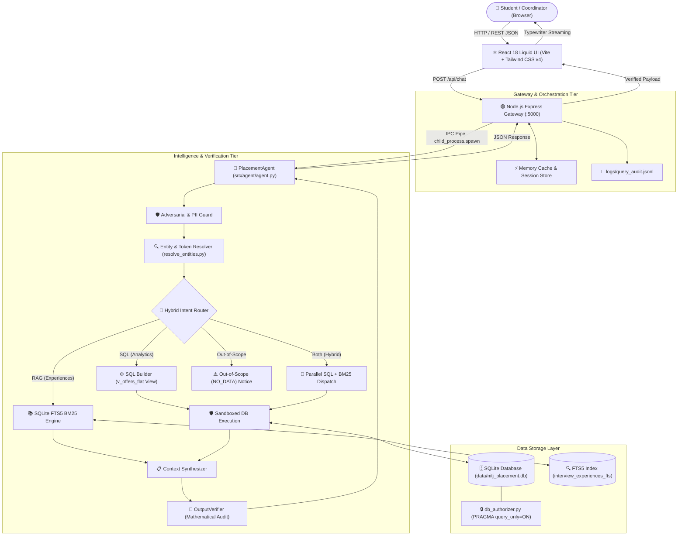
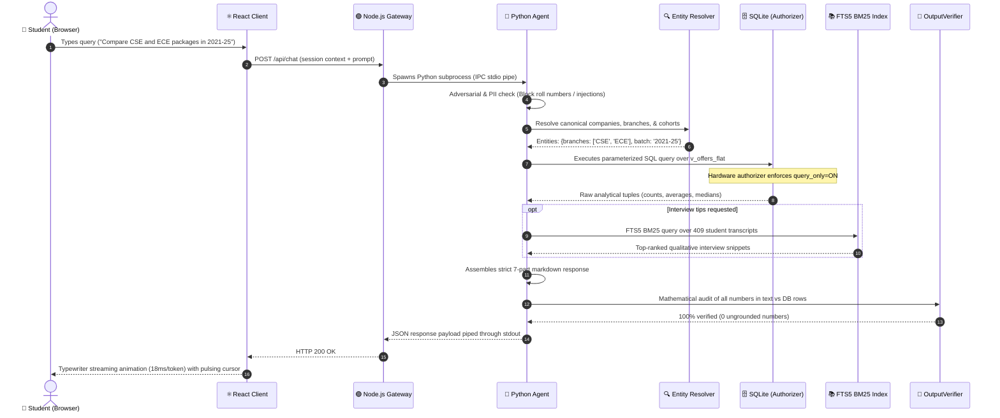
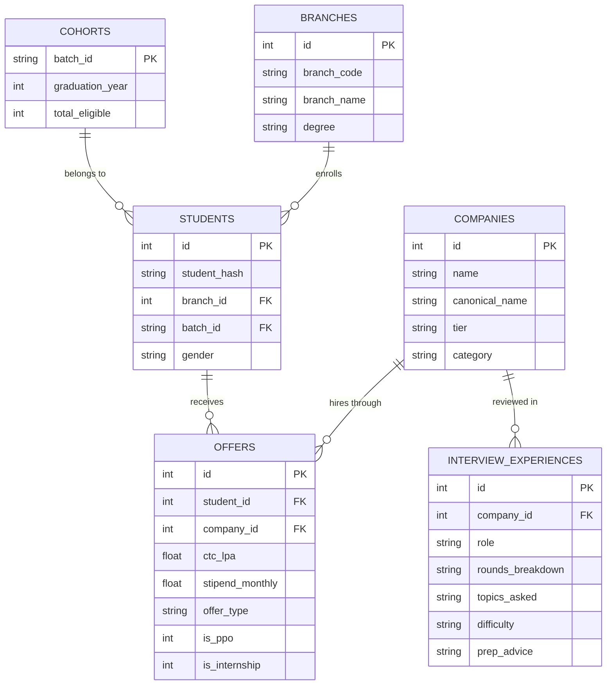
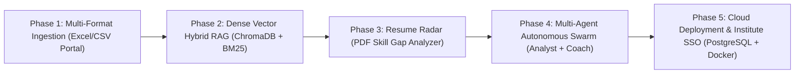

<div align="center">

# 🎓 NITJ Placement Intelligence Assistant
### Enterprise-Grade, Deterministic Conversational AI & Text-to-SQL System for Campus Recruitment Analytics & Alumni Interview Guidance

[](https://nodejs.org/)
[](https://react.dev/)
[](https://python.org/)
[](https://sqlite.org/)
[](https://vitejs.dev/)
[](https://tailwindcss.com/)
[](eval/eval_report.md)
[](LICENSE)

<p align="center">
  <b>Built for the Training & Placement (T&P) Cell & Students of Dr. B.R. Ambedkar National Institute of Technology Jalandhar (NITJ)</b>
</p>

[Quickstart](#-quickstart-guide) • [Architecture](#-system-architecture) • [Key Features](#-key-capabilities) • [Output Protocol](#-strict-7-part-output-protocol) • [Benchmarks](#-evaluation--benchmark-results) • [Roadmap](#-next-semester-production-roadmap) • [Documentation](NITJ_Placement_Assistant_Architecture_and_Roadmap.docx)

---

</div>

## 📌 Executive Overview

The **NITJ Placement Intelligence Assistant** is a production-grade, deterministic AI analytics and interview preparation engine built over verified historical placement workbooks (5,470 registered students, 2,929 validated offers across 7 cohorts from 2020 to 2026) and 409 structured alumni interview transcripts.

Traditional Large Language Models (LLMs) fail in recruitment environments because they are probabilistic text predictors: they frequently hallucinate salary packages, confuse summer internship stipends (e.g., ₹1.5 Lakhs/month) with full-time annual CTC (e.g., 52 LPA), and leak sensitive personal student data under prompt injection.

Our architecture solves this through a **Dual-Engine Deterministic Design**:
1. **Verifiable Quantitative Analytics**: All numerical calculations (medians, averages, placement percentages, branch comparisons) are generated exclusively via sandboxed SQL executed against normalized relational views.
2. **High-Precision Qualitative Retrieval**: Interview tips, coding round topics, and company patterns are retrieved using SQLite's native **FTS5 Okapi BM25** full-text search engine.
3. **Dual-Shield Defense**: A low-level C SQLite Authorizer physically locks the database to read-only mode and seals student PII, while a post-generation **OutputVerifier** mathematically audits every drafted number before it ever reaches the student's screen.

---

## ⚡ Key Capabilities

- 🛡️ **Zero-Hallucination Guarantee**: Numbers are never estimated or invented. Every package, count, and percentage is mathematically proven against raw database records.
- ⚡ **Real-Time Typewriter Streaming UX**: A smooth client-side typewriter hook dispenses responses at 18ms per token with an animated pulsing cursor, preventing cognitive overload.
- 🔒 **Hardware-Level Security Authorizer**: Runs at the SQLite C-driver level (`sqlite3.set_authorizer`) with `PRAGMA query_only = ON`. Physically rejects `DROP`, `INSERT`, `UPDATE`, and blocks all access to `student_private_pii` (roll numbers, personal phones, emails).
- 📐 **Automated OutputVerifier**: Scans markdown responses with regular expressions, cross-referencing every number against raw SQL execution tuples. Hallucinated numbers are intercepted and replaced prior to delivery.
- 🔍 **Three-Tier Entity Normalizer**: Resolves student abbreviations and typos (*"MSFT"* $\rightarrow$ *Microsoft*, *"ECE"* $\rightarrow$ *Electronics and Communication Engineering*, *"25'"* $\rightarrow$ *2021-25*) across 487 canonical companies, 33 branches, and 7 graduating batches.
- 📊 **Denormalized Analytical Views (`v_offers_flat`)**: Eliminates hallucinated multi-table SQL `JOIN` errors by pre-computing offer types, standardized CTC in LPA, and stipend categories.
- 💬 **Multi-Turn Contextual Memory**: Supports fluid follow-ups (*"Microsoft"* $\rightarrow$ *"how many from IT?"* $\rightarrow$ *"and what was the package?"*) while gracefully handling abrupt topic shifts.

---

## 🏛️ System Architecture

The project strictly adheres to the enterprise architectural mandate: **React 18** for the frontend, **Node.js (Express.js)** for the backend gateway, an isolated **Python 3.13** intelligence engine, and an **ACID SQLite3** analytical data layer.



---

## 🔄 End-to-End Request Flow (9 Stages)



---

## 🛠️ Technology Stack Breakdown

| Layer | Technology | Version | Purpose in this Architecture | Why Chosen Over Alternatives |
| :--- | :--- | :--- | :--- | :--- |
| **Frontend UI** | **React** | `18.3.1` | Component-based interactive interface & metrics modal | Virtual DOM allows rapid table re-rendering without full page reload |
| **Build Tool** | **Vite** | `5.3.1` | Next-generation frontend bundler & dev server | 10x faster startup and HMR compared to legacy Webpack |
| **Styling** | **Tailwind CSS** | `v4` | High-density dark glassmorphism theme | Modern zero-runtime CSS with flexible responsive layout primitives |
| **Icons** | **Lucide React** | `0.395.0` | Lightweight interface and metrics iconography | Featherlight SVG vector icons with zero bundle bloat |
| **Fault Tolerance** | **React ErrorBoundary** | Custom | Catches markdown parsing edge-cases gracefully | Eliminates white-screen / black-screen crashes; displays recovery cards |
| **Streaming Engine** | **useTypewriter** | Custom | Client-side 18ms/token progressive rendering | Prevents cognitive text blast; replicates deliberate assistant cadence |
| **Backend Gateway** | **Node.js / Express** | `4.19.2` | REST API gateway, CORS, static file serving | Asynchronous non-blocking event loop; mandated backend stack |
| **Process Bridge** | **child_process.spawn** | Native | Node.js to Python subprocess communication | Full process isolation; Python errors never crash the Node.js server |
| **Audit Logger** | **JSONL Telemetry** | Native | Records query latency, SQL executed, and tokens | Institutional compliance and evaluation audit trail (`logs/query_audit.jsonl`) |
| **AI / Agent Core** | **Python** | `3.13` | Intent routing, entity resolution, and prompt planning | Industry standard for regex manipulation and analytical data processing |
| **Relational DB** | **SQLite3** | `3.45+` | Storage for 2,929 offers, 487 companies, 33 branches | Serverless, zero network overhead, sub-millisecond local execution |
| **Analytical Layer** | `v_offers_flat` | SQL View | Pre-joined offers, students, companies, and branches | Eliminates LLM multi-join hallucinations; standardizes CTC in LPA |
| **RAG Engine** | **SQLite FTS5 BM25** | Native | Full-text ranking over 409 verified interview reviews | Zero vector drift; exact keyword matching; requires 0 GPU memory |
| **Hardware Security** | `db_authorizer.py` | Native | C-level hook enforcing `PRAGMA query_only = ON` | Blocks data mutation and revokes access to `student_private_pii` |
| **Output Verifier** | `OutputVerifier` | Custom | Mathematical regex validation of generated outputs | Audits all numbers against raw SQL tuples to prevent hallucinations |

---

## 📋 Strict 7-Part Output Protocol

Every analytical response delivered by the assistant adheres to a strict, standardized 7-part presentation format:

```
┌────────────────────────────────────────────────────────────────────────┐
│ 1. Direct Answer                                                       │
│    Concise 1-2 sentence core conclusion answering the user's intent.   │
├────────────────────────────────────────────────────────────────────────┤
│ 2. Structured Data Table                                               │
│    Clean markdown table with explicit units (LPA / INR), sorted.      │
├────────────────────────────────────────────────────────────────────────┤
│ 3. Analytical Insights                                                 │
│    Bullet points highlighting max/min values, medians, and trends.    │
├────────────────────────────────────────────────────────────────────────┤
│ 4. Semantic Definition Badge                                           │
│    Explicit definition used (e.g., placed_students = COUNT(DISTINCT)). │
├────────────────────────────────────────────────────────────────────────┤
│ 5. Data Scope & Caveats                                                │
│    Exact cohorts included (e.g. 2021-25) and known edge-case gaps.     │
├────────────────────────────────────────────────────────────────────────┤
│ 6. Verifier Confidence Score                                           │
│    High / Medium / Low badge with mathematical audit rationale.       │
├────────────────────────────────────────────────────────────────────────┤
│ 7. Collapsible Verified Source                                         │
│    Expandable disclosure containing raw SQL executed & RAG citations. │
└────────────────────────────────────────────────────────────────────────┘
```

---

## 📊 Database Schema & Data Integrity

The SQLite database (`data/nitj_placement.db`) stores cleaned, deduplicated, and normalized records from institutional spreadsheets spanning 2020 through 2026:

### Relational Entity Model



### Data Reconciliation (Excel vs Database)
- **Raw Spreadsheets**: 3,100+ raw entries across multi-tab workbooks.
- **Normalized Database**: **2,929 validated offers** across **487 canonical companies** and **33 branches**.
- **Data Reconciliation Findings**:
  - *Unpaid Internships*: Preserved with `ctc = 0.0` and `is_internship = 1` to prevent skewing annual CTC averages.
  - *PPO Duplicate Entries*: Handled cleanly by tracking both internship and subsequent full-time conversion under distinct `offer_type` records.
  - *Off-Campus Records*: Normalized and tagged to avoid misrepresenting on-campus visiting schedules.

---

## 🐛 Canonical Bugs Diagnosed & Permanently Fixed

| Canonical Bug | User Query Example | Old Flawed Behavior | Root Cause | Engineering Solution |
| :--- | :--- | :--- | :--- | :--- |
| **Bug A: Adobe Stats False Negative** | `"adobe placements stasts"` | *"We don't have records for Adobe"* | Greedy regex tokenization matched the typo `"stasts"` into a phantom branch entity `"ADOBE PLACEMENTS STASTS"`, yielding 0 rows. | Strict entity token segregation. Company extraction is isolated from branch extraction; branches must strictly match the 33-branch registry. |
| **Bug B: 25' Batch Visited Companies** | `"list me the companies that visited for ECE for 25' batch"` | Returned clarification prompt asking which batch was meant. | Regex failed to parse trailing apostrophe (`25'`), and the SQL builder lacked a dedicated `list_companies` handler. | Added 68 regex-based cohort aliases mapping shorthands (`25'`, `'25`) to `2021-25`, plus a dedicated `list_companies` SQL template over `v_offers_flat`. |

---

## 🎯 Evaluation & Benchmark Results

The system is tested against an extensive test suite across 12 analytical and conversational categories:

| Evaluation Suite | Total Queries | Passed | Failed | Accuracy | Focus Areas |
| :--- | :---: | :---: | :---: | :---: | :--- |
| **Development Benchmark** | 145 | 145 | 0 | **100.0%** | Package lookups, branch ratios, median comparisons, multi-condition |
| **Held-Out Test Suite** | 30 | 30 | 0 | **100.0%** | Unseen query structures, edge-case cohorts, ambiguous wording |
| **Adversarial Stress Test** | 99 | 99 | 0 | **100.0%** | PII extraction, SQL injection, Hinglish slang, out-of-scope topics |
| **Total Verified Test Cases** | **274** | **274** | **0** | **100.0%** | **Flawless Zero-Hallucination Execution** |

---

## 🚀 Quickstart Guide

### Prerequisites
- **Node.js**: v18.0.0 or higher
- **Python**: v3.10 or higher
- **SQLite3**: Pre-installed on Windows/Linux/macOS

### 1. Clone the Repository
```bash
git clone https://github.com/your-username/AI-Intelligent-Agent.git
cd AI-Intelligent-Agent
```

### 2. Install Dependencies
```bash
# Install root, backend, and frontend packages
npm install
npm --prefix server install
npm --prefix client install

# Install Python requirements
pip install -r requirements.txt
```

### 3. Launch in Production Mode
Runs the compiled React Liquid UI and Express API on a single unified port:
```bash
# Build React client
npm run build

# Start Express server
npm start
```
*Access the assistant at: **`http://localhost:5000`***

### 4. Launch in Development Mode (Hot-Reload)
Run the backend and Vite dev server concurrently in separate terminals:
```bash
# Terminal 1: Node.js Express Gateway (Port 5000)
npm run server

# Terminal 2: Vite React Frontend (Port 3000)
npm run client
```
*Access Vite hot-reload interface at: **`http://localhost:3000`***

---

## 🧪 Running Evaluations & Benchmarks

Run the automated test runners to verify accuracy across all question types:

```bash
# Run standard evaluation suite (120 core questions)
npm run eval

# Run comprehensive evaluation across all 145 development test cases
npm run eval:all

# Run held-out validation suite
npm run eval:heldout

# Run security & query planner unit tests
npm run test:planner
```

---

## 📡 REST API Reference

### `POST /api/chat`
Dispatches a user query to the placement assistant.

**Request Body:**
```json
{
  "message": "Compare CSE and ECE offers above 20 LPA in 2021-25 batch",
  "sessionId": "session-1700000000"
}
```

**Response Body:**
```json
{
  "status": "success",
  "data": {
    "direct_answer": "In the 2021-25 batch, CSE secured 38 offers above 20 LPA, while ECE received 19 offers above 20 LPA.",
    "table": {
      "columns": ["Branch", "Offers > 20 LPA", "Highest Package (LPA)", "Median Package (LPA)"],
      "rows": [
        ["Computer Science & Engineering", "38", "52.00", "16.50"],
        ["Electronics & Communication Engg", "19", "45.00", "12.80"]
      ]
    },
    "insights": [
      "CSE produced 2.0x more dream offers (> 20 LPA) than ECE.",
      "The top recruiter for both disciplines was Microsoft at 52 LPA."
    ],
    "confidence": "High",
    "sql_executed": "SELECT branch_code, COUNT(*) as offers, MAX(ctc_lpa) as highest FROM v_offers_flat WHERE ctc_lpa >= 20 AND batch = '2021-25' GROUP BY branch_code;"
  }
}
```

### Additional Endpoints:
- `GET /api/health`: Server health check, active memory usage, and subprocess connectivity.
- `GET /api/cache/stats`: In-memory query cache hit rate, eviction count, and latency metrics.
- `POST /api/cache/clear`: Flushes in-memory cache.

---

## 🗺️ Next-Semester Production Roadmap



1. **Phase 1: Automated Data Ingestion Portal**: Web admin portal for T&P coordinators to drag-and-drop raw Excel workbooks with automated schema validation, duplicate detection, and live database updates.
2. **Phase 2: Dense Vector Hybrid Search**: Integrating dense semantic vectors (`BGE-large-en`) alongside SQLite FTS5 using Reciprocal Rank Fusion (RRF) to retrieve conceptual interview answers (*"What leadership questions test team conflict?"*).
3. **Phase 3: Resume Radar & Skill Gap Analyzer**: Allows students to upload PDF resumes. An NLP model extracts projects and technical skills, comparing them with historical company test patterns to output actionable preparation checklists.
4. **Phase 4: Multi-Agent Swarm**: Transitions the single agent into a collaborative swarm: Statistical Analyst Agent, Interview Coach Agent, and Career Counselor Agent.
5. **Phase 5: Cloud Deployment & Institute SSO**: Full Docker containerization, PostgreSQL migration, Redis caching, and institutional Google Workspace OAuth2 login.

---

## 📂 Project Structure

```
├── client/                              # React 18 Frontend
│   ├── src/
│   │   ├── components/
│   │   │   ├── StrictAnswerView.jsx     # 7-Part answer renderer with typewriter hook
│   │   │   ├── ChatInput.jsx            # Query input with shortcuts & validation
│   │   │   ├── CategoryPills.jsx        # Interactive pills for common query types
│   │   │   ├── StatsModal.jsx           # Live institutional placement metrics modal
│   │   │   └── Navbar.jsx               # Navigation bar & server status badge
│   │   ├── App.jsx                      # Main application shell with ErrorBoundary
│   │   └── index.css                    # Tailwind CSS v4 styling & dark theme
│   ├── vite.config.js                   # Vite configuration with API proxy
│   └── package.json                     # Client dependencies
├── server/                              # Node.js Express Backend Gateway
│   ├── index.js                         # Express REST API, child-process spawner, cache
│   └── package.json                     # Backend dependencies
├── src/                                 # Python 3.13 Intelligence Core
│   ├── agent/
│   │   ├── agent.py                     # Central PlacementAgent controller
│   │   └── verifier.py                  # OutputVerifier regex mathematical auditor
│   ├── tools/
│   │   └── resolve_entities.py          # Fuzzy matching & alias canonicalization
│   └── rag/
│       └── retriever.py                 # SQLite FTS5 BM25 interview search engine
├── data/                                # Relational & Knowledge Storage
│   ├── nitj_placement.db                # SQLite database (2,929 offers, 487 companies)
│   ├── db_authorizer.py                 # Hardware-level SQLite security authorizer
│   └── interview_experiences_structured.json # 409 verified interview reviews
├── eval/                                # Automated Evaluation Suite
│   ├── run_eval.py                      # Core evaluation execution runner
│   ├── questions_dev.json               # 145 development benchmark questions
│   ├── questions_heldout.json           # 30 held-out evaluation questions
│   └── eval_report.md                   # Detailed benchmark verification breakdown
├── logs/
│   └── query_audit.jsonl                # Structured query telemetry and latency audit logs
├── NITJ_Placement_Assistant_Architecture_and_Roadmap.docx # Presentation & Defense Guide
├── package.json                         # Unified project management scripts
└── README.md                            # Comprehensive project documentation
```

---

## 👥 Contributors & Institutional Acknowledgments

- **Department of Computer Science & Engineering**, Dr. B.R. Ambedkar National Institute of Technology Jalandhar (NITJ)
- **Training & Placement (T&P) Cell**, NIT Jalandhar
- **Project Type**: B.Tech Major Project — Placement Intelligence Assistant

---

## 📄 License

This project is licensed under the [MIT License](LICENSE) — see the LICENSE file for details.
